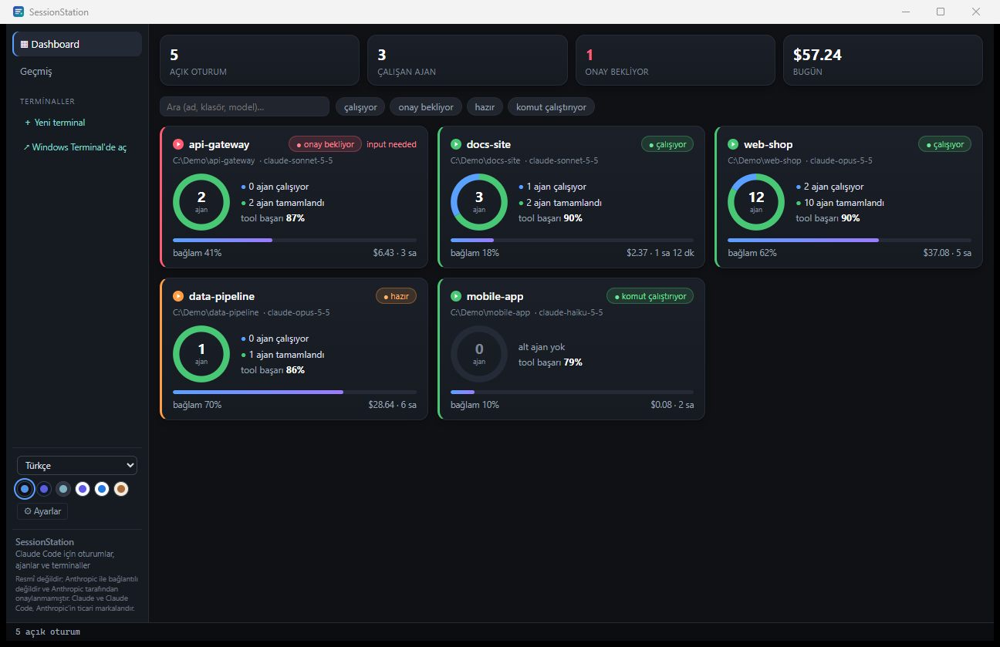
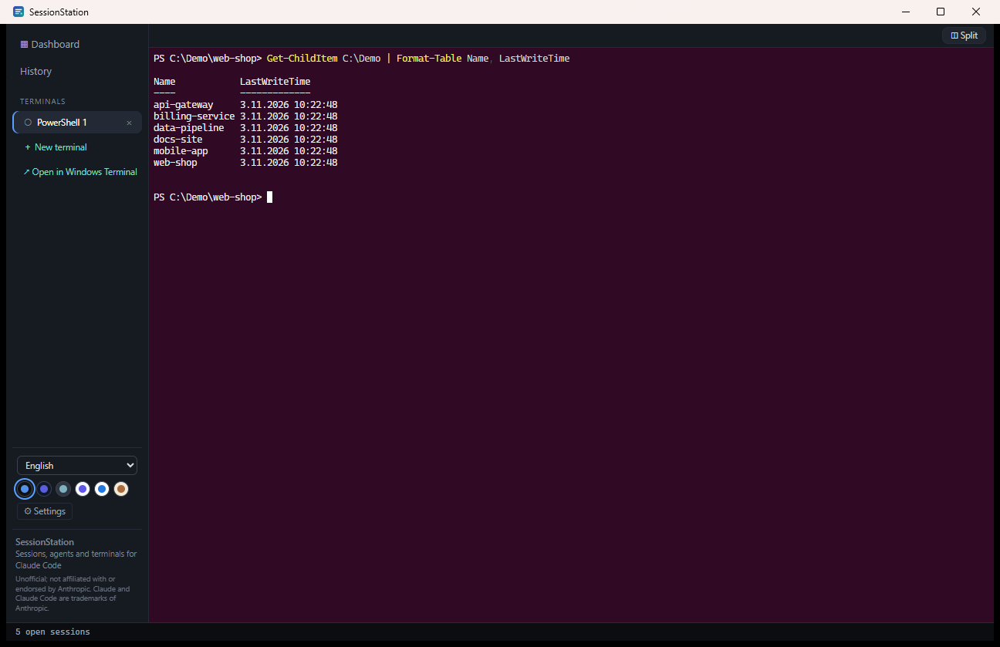
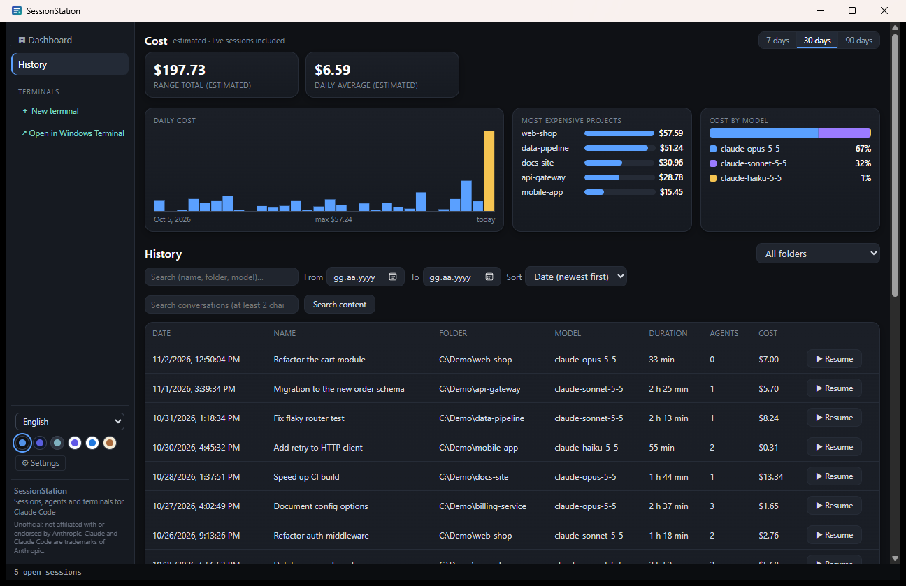

# SessionStation

**Sessions, agents and terminals for Claude Code.**

> **Unofficial; not affiliated with or endorsed by Anthropic. Claude and Claude
> Code are trademarks of Anthropic.**

[](https://github.com/cafercan/session-station/actions/workflows/ci.yml)
[](LICENSE)


[Türkçe özet](#türkçe)

SessionStation is a Windows desktop app that shows every local Claude Code
session in one window: what each one is doing, its subagents, context usage
and token usage (with an estimated cost). It also runs real PowerShell terminals right next to them.
It is built with Tauri 2, a Rust core and a React/TypeScript UI.

| Dashboard | Terminal | History |
|---|---|---|
|  |  |  |

*Screenshots are produced with demo data (made-up sessions, folders and
costs), not from a real machine.*

## Contents

- [Why](#why)
- [Features](#features)
- [Privacy and security](#privacy-and-security)
- [Requirements](#requirements)
- [Installation](#installation)
- [Usage tips](#usage-tips)
- [Building from source](#building-from-source)
- [Project layout](#project-layout)
- [Roadmap](#roadmap)
- [Contributing](#contributing)
- [Security](#security)
- [License](#license)
- [Acknowledgements](#acknowledgements)
- [Türkçe](#türkçe)

## Why

If you use Claude Code a lot, you probably have several sessions open at once,
in different project folders, spread over Windows Terminal tabs, VS Code and
other windows. It gets hard to tell which one is waiting for your approval,
which one has finished, how many subagents are running and what the day has
cost. SessionStation reads Claude Code's local files and puts all of that on
one dashboard. It can also take you to the tab a session runs in, or resume a
closed session in its own folder.

## Features

### Live dashboard

- One card per running Claude Code session. Each card has a status badge and a
  colored edge: **running** (green), **running command** (green),
  **ready** (orange), **waiting for approval** (coral red), **closed** (grey).
- An agents donut shows running and finished subagents, next to the tool
  success rate over the session's recent tool calls.
- A context bar shows how much of the model's context window is used. If a
  model's window size is not known, it shows "?" instead of guessing.
- Token usage (exact) and elapsed time for each session, with the estimated
  dollar cost shown smaller next to it, and summary figures at the top.
- Search by name, folder or model (case- and accent-insensitive, including
  Turkish İ/ı), plus status filter chips.

### Session detail

- The subagent tree and the most recent tool calls.
- **Go to tab**: switches to the embedded terminal that hosts the session, or
  brings the hosting Windows Terminal window forward and selects the tab whose
  title matches the session name. This is best-effort: if several tabs share
  the name, only the window is focused. The button is hidden for sessions in
  other hosts (for example VS Code).
- **Resume** for a closed session (see History).

### History

- A background indexer builds a summary of past sessions and caches it, so
  later starts are fast.
- Usage charts: daily tokens for the last 7, 30 or 90 days, the top
  projects, and the split by model. All three include the sessions that are
  still running; the dollar amounts next to the token counts are labeled as
  estimates. The page refreshes
  them every 30 seconds while it is open.
- Filter by text and date range, and sort by date or tokens.
- Content search inside the transcripts of both live and past sessions. It
  streams the files and returns short snippets. It stops at 50 hits, after
  8 seconds or 2 GiB read, or when you cancel it (Clear, or leaving the page);
  a result cut short is marked as such.
- **Resume**: opens a new embedded terminal in the session's project folder and
  runs `claude --resume <session id>`. The app looks up the folder from the
  transcript itself; the UI only sends the session id. A session that is
  still live is not resumed a second time.

### Embedded terminals

- Real PowerShell through Windows ConPTY ([portable-pty]), rendered by
  [xterm.js] with its WebGL renderer, so the box-drawing and block characters
  in Claude Code's interface line up. If WebGL is not available, it falls back
  to the default renderer.
- Ubuntu color scheme in every app theme, Cascadia Mono / Consolas font,
  10,000 lines of scrollback, Unicode 11 character widths.
- Split view: two terminals side by side with a draggable divider.
- Clipboard like Windows Terminal: Ctrl+C copies when text is selected and
  otherwise sends ^C; Ctrl+V and right-click paste; Ctrl+Shift+C/V always
  copy/paste.
- Search with Ctrl+F. Change the font size with Ctrl+mouse wheel or
  Ctrl+= / Ctrl+-, and reset it with Ctrl+0.
- **Open in Windows Terminal**: opens a new PowerShell tab in your home folder
  in Windows Terminal. Sessions started there still appear on the dashboard.
- **Open folder** opens a session's project folder in Explorer.

### Notifications and tray

- Windows toast notifications when a session starts waiting for approval, when
  a session finishes after working for at least 10 seconds, and (optional,
  off by default) when a subagent finishes. Each has its own switch in
  Settings. A session gets at most one notification every 15 seconds (one
  that comes sooner is shown when the 15 seconds are up, if it still applies).
  While the app window is focused, there is no notification for the session
  shown in the detail view or in either visible pane of a split terminal.
- While the app is running, clicking one of its recent notifications opens
  that session's detail. Notifications left in the Action Center from before
  the app was restarted do not.
- A tray icon whose tooltip counts open and waiting sessions. It shows an
  attention dot while any session is waiting, and its menu lists up to 5
  waiting sessions.
- Closing the window can minimize it to the tray (on by default), so terminals
  and monitoring keep running.
- Only one copy runs at a time. Launching it again brings the existing window
  forward; if that copy does not respond within 3 seconds, a message says so
  instead.

### Keyboard shortcuts

App shortcuts use chords that do not collide with PowerShell/PSReadLine or
Claude Code. Every other key goes to the terminal.

Keys are physical positions on a US layout: the letters work the same on any
keyboard layout (Cyrillic, Turkish F, ...), and `/` and `\` mean the keys at
those positions (on ISO keyboards the extra key next to left Shift also works
for `\`). The in-app shortcut help (Ctrl+Shift+/) shows the key your layout
has there, for example `.` and `,` on Turkish Q.

| Shortcut | Action |
|---|---|
| Ctrl+Shift+T | New terminal |
| Ctrl+Shift+W | Close the current terminal (asks first if needed) |
| Ctrl+Alt+1 … 9 | Switch to terminal 1 … 9 |
| Ctrl+Tab / Ctrl+Shift+Tab | Next / previous terminal |
| Ctrl+Shift+\\ | Toggle split view |
| Ctrl+Shift+D | Dashboard |
| Ctrl+Shift+H | History |
| Ctrl+Shift+F | Focus the search box of the current page |
| Ctrl+Shift+P | Command palette (actions, open sessions, terminals) |
| Ctrl+Shift+/ | Shortcut help |

Inside a terminal: Ctrl+C / Ctrl+V, Ctrl+Shift+C / Ctrl+Shift+V, Ctrl+F and
Ctrl+= / Ctrl+- / Ctrl+0 work as described above.

### Languages and themes

- 8 UI languages: Türkçe (default), Azərbaycan dili, English, Deutsch,
  Русский, Español, Français, 简体中文. The language changes instantly.
- 6 themes: Pano Dark (default), Obsidian Dark, Nord Frost, Classic Light,
  GitHub Light, Sepia. The embedded terminal keeps its Ubuntu color scheme in
  every theme.

## Privacy and security

These are guarantees of the code in this repository:

- **Read-only access to Claude Code's files.** SessionStation reads
  `~/.claude` (or `CLAUDE_CONFIG_DIR` if it is set) and never writes there. It
  never opens `sessions/*.key` files.
- **The app makes no network requests.** It has no telemetry, no analytics, no
  auto-updater and no listening ports. The WebView2 runtime and Windows may
  make their own connections, outside the app's control. Programs you run in
  an embedded terminal, such as `claude` itself, use the network as they
  normally would.
- **No hooks and no settings changes.** It does not install Claude Code hooks
  and does not modify Claude Code settings.
- **Locked-down UI.** A strict Content Security Policy allows no remote
  scripts, styles, fonts or connections. The UI talks to the Rust core only
  through Tauri IPC commands. Capabilities are narrowed to exactly the
  commands the UI uses, and the core validates every argument: session ids
  must be UUIDs, and folders and resume paths are resolved on the Rust side,
  never taken from the UI.
- **What it writes:**
  - In its own app data folder (`%APPDATA%\com.cafercan.sessionstation`):
    the history cache (`history-cache.json`), `settings.json`, and a copy of
    the app icon used by notifications.
  - One registry key,
    `HKCU\Software\Classes\AppUserModelId\com.cafercan.sessionstation`, which
    Windows needs to show the app's notifications. The uninstaller does not
    remove it.
  - Your language and theme choices are kept in the WebView's local storage.

> **Note:** SessionStation relies on Claude Code's **undocumented** local file
> formats (session transcripts, `sessions/*.json`, subagent metadata). These
> can change with any Claude Code update. Unknown fields are skipped, but some
> information may be missing or wrong until SessionStation is updated.

## Requirements

- Windows 10 or 11, x64
- Microsoft Edge WebView2 Runtime (preinstalled on Windows 11 and on current
  Windows 10 installs)
- Claude Code, installed and used on the same machine
- Optional: Windows Terminal, for "Open in Windows Terminal" and "Go to tab"

## Installation

Download `SessionStation-v*-windows-x64-setup.exe` from the
[Releases](../../releases) page and run it.

- The install is per user and needs no administrator rights.
- The installer is not code-signed yet, so Windows SmartScreen may warn you.
  Choose "More info", then "Run anyway".
- `LICENSE` and `THIRD_PARTY_NOTICES.md` are installed next to the app.

## Usage tips

- Start Claude Code anywhere (Windows Terminal, an embedded terminal, VS
  Code). The dashboard picks sessions up on its own; there is nothing to
  configure.
- Check the notification switches in **Settings** (gear button at the bottom
  of the sidebar) and leave the app in the tray. It will then tell you when a
  session needs approval.
- Press Ctrl+Shift+P to jump to any session or terminal by name.
- Use **Resume** on the History page to continue a closed session in its own
  folder, inside an embedded terminal.
- Token counts are exact: they come straight from the transcripts. Dollar
  amounts are only an estimate from a price table built into the app, which
  can be out of date when prices change or a new model ships (models it does
  not know show tokens only). Your actual bill or plan usage may differ.

## Building from source

Prerequisites:

- Rust with the MSVC toolchain (`x86_64-pc-windows-msvc`; CI pins 1.99.1)
- Visual Studio 2022 Build Tools with the "Desktop development with C++"
  workload
- Node.js 22
- Inno Setup 6 (only for the installer)

```powershell
npm ci
npm --prefix ui ci

npm run tauri dev        # development mode with hot reload
npm run debug-preview    # fast debug build, no installer
npm run installer        # release build + Inno Setup installer in dist/ (needs Inno Setup 6)
```

Tests and checks:

```powershell
cargo test --workspace
npm --prefix ui test
cargo clippy --workspace -- -D warnings
```

### Demo data

`scripts/demo-data.ps1` builds a fake Claude config dir (5 live sessions with
dummy processes, ~25 closed sessions, subagents and a workflow, all made up)
for screenshots and demos. It also creates folders under `C:\Demo`.

```powershell
.\scripts\demo-data.ps1                 # default dir: %TEMP%\sessionstation-demo
$env:CLAUDE_CONFIG_DIR="$env:TEMP\sessionstation-demo"; & .\target\debug\session-station.exe
.\scripts\demo-data.ps1 -Stop           # kill the dummy processes, remove the demo dir and C:\Demo folders
```

Third-party notices are generated offline from `Cargo.lock`, the local cargo
registry and `ui/node_modules`:

```powershell
node scripts/gen-notices.mjs            # regenerate THIRD_PARTY_NOTICES.md (also: npm run notices)
node scripts/gen-notices.mjs --check    # verify it is up to date (CI runs this)
```

CI ([`.github/workflows/ci.yml`](.github/workflows/ci.yml)) runs the tests,
the notices check, `cargo audit`, `npm audit` and gitleaks on Windows.

## Project layout

| Path | Contents |
|---|---|
| `core/` | `station-core`: Rust library that locates and parses Claude Code's local files, tracks live sessions, builds the agent tree, and computes context usage and cost |
| `src-tauri/` | `session-station`: the Tauri app with IPC commands, terminals (PTY), history index, notifications, tray and Windows integration |
| `ui/` | React + TypeScript front end (Vite), xterm.js terminals, i18n dictionaries, themes |
| `scripts/` | `gen-notices.mjs`, which generates the third-party notices |
| `assets/` | Logo source |

## Roadmap

- Linux support
- More polish across the UI and terminals
- Native-speaker review of the translations

## Contributing

Issues and pull requests are welcome. Please run the tests above before
opening a PR, and keep the privacy guarantees intact: no network access, no
writes under `~/.claude`, and every IPC argument treated as untrusted.

Translations are especially welcome. Turkish is the original language. The
other seven dictionaries in `ui/src/i18n/` (Azerbaijani, English, German,
Russian, Spanish, French, Chinese) were translated with AI help and would
benefit from review by native speakers.

## Security

Please report vulnerabilities privately as described in
[SECURITY.md](SECURITY.md). Do not open a public issue for them.

## License

[MIT](LICENSE). Third-party components and their licenses are listed in
[THIRD_PARTY_NOTICES.md](THIRD_PARTY_NOTICES.md).

## Acknowledgements

SessionStation is built on [Tauri], [xterm.js], [portable-pty] and [React],
along with the other open-source projects listed in the third-party notices.

[Tauri]: https://tauri.app
[xterm.js]: https://xtermjs.org
[portable-pty]: https://crates.io/crates/portable-pty
[React]: https://react.dev

---

## Türkçe

**SessionStation**, Claude Code oturumlarını, alt ajanlarını ve terminallerini
tek pencerede gösteren bir Windows masaüstü uygulamasıdır. Resmî değildir;
Anthropic ile bağlantılı değildir ve Anthropic tarafından onaylanmamıştır.
Claude ve Claude Code, Anthropic'in ticari markalarıdır.

- **Canlı pano:** her oturum için durum (çalışıyor, hazır, onay bekliyor,
  kapandı), alt ajan halkası, bağlam yüzdesi ve token kullanımı (tahmini maliyet ikincil); arama ve
  durum filtresi.
- **Oturum ayrıntısı:** alt ajan ağacı, son tool çağrıları, "Sekmeye git"
  (gömülü terminal ya da Windows Terminal sekmesi), kapanmış oturumu sürdürme.
- **Geçmiş:** önbellekli dizin, kullanım grafikleri (token, tahmini $; 7/30/90 gün, projeler,
  modeller; çalışan oturumlar dahil), canlı ve geçmiş oturumlarda içerikte
  arama (50 sonuç, 8 sn, 2 GiB ya da iptalde durur), "Devam et" ile
  `claude --resume`.
- **Gömülü terminal:** ConPTY üzerinden gerçek PowerShell, WebGL ile çizim,
  Ubuntu renkleri, bölünmüş görünüm, kopyala/yapıştır, arama, yazı boyutu,
  "Windows Terminal'de aç".
- **Bildirimler ve tepsi:** onay bekleyen ve biten oturumlar için Windows
  bildirimi (pencere odaktayken ayrıntıda ya da bölünmüş görünümün iki
  bölmesinde görünen oturum için bildirim yok; bildirime tıklamak uygulama
  çalışırken son bildirimlerde oturumu açar), tepsi simgesi, tek kopya çalışma.
- **Klavye kısayolları** (fiziksel tuş konumları; her klavye düzeninde
  çalışır), 8 arayüz dili ve 6 tema.

**Gizlilik:** `~/.claude` yalnızca okunur (`sessions/*.key` hiç açılmaz).
Uygulamanın kendisi ağ isteği yapmaz; telemetri ve otomatik güncelleme yoktur.
Hook kurmaz, Claude Code ayarlarını değiştirmez. Yalnızca kendi uygulama veri
klasörüne (geçmiş önbelleği, ayarlar) ve bildirimler için bir HKCU kayıt
anahtarına yazar. Claude Code'un belgelenmemiş dosya biçimlerine dayanır; bu
biçimler değişebilir.

**Kurulum:** [Releases](../../releases) sayfasından
`SessionStation_*_x64-setup.exe` dosyasını indirip çalıştırın. Kurulum
kullanıcı bazlıdır, yönetici yetkisi gerekmez; kurulum dosyası henüz imzalı
değildir. Gereksinimler: Windows 10/11 x64,
WebView2, Claude Code.

Kaynaktan derleme, testler ve katkı için yukarıdaki İngilizce bölümlere
bakın. Lisans: [MIT](LICENSE).
